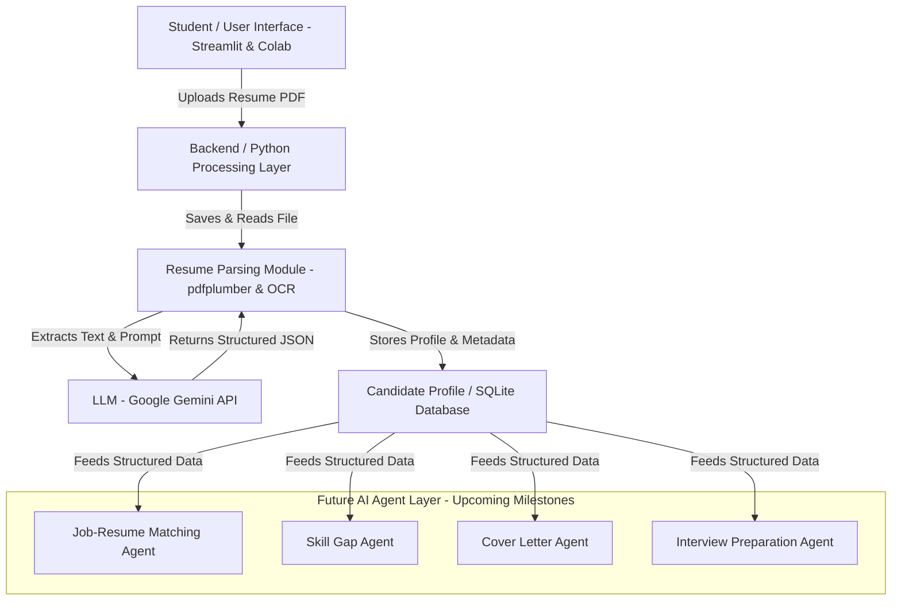

# 🚀 AI-Powered Internship & Career Assistant

## 📌 Milestone 1: Foundation & Candidate Understanding

This project is an intelligent career assistant designed to automate the internship application workflow. In **Milestone 1**, the focus is on designing the system architecture, defining multi-agent roles, building the student profile upload pipeline, and implementing LLM-powered structured resume parsing.

---

## 🛠️ Tech Stack

* **Programming Language:** Python 3.10+
* **LLM & AI Engine:** Google Gemini API (`gemini-1.5-flash` / `gemini-3.8-flash`)
* **Resume Processing & OCR:** `pypdf`, `pdfplumber`, `pytesseract`, `pdf2image`
* **Database:** SQLite (Local relational storage for structured profiles)
* **User Interface & Prototyping:** Google Colab & Streamlit

---

## 🏗️ System Architecture

Below is the end-to-end data flow and system architecture designed for this platform. GitHub natively renders the Mermaid diagram below:

### 🔄 Data Flow Explanation
1. **Student/User Interface:** Allows candidates to upload their resumes in PDF format.
2. **Resume Parsing Module:** Extracts raw text from standard PDFs using `pdfplumber`/`pypdf` and falls back to Optical Character Recognition (`pytesseract`) for scanned documents.
3. **LLM Extraction Engine:** Sends extracted text to Google Gemini with strict prompt engineering to output standardized JSON containing skills, education, and project experience.
4. **Candidate Profile Storage:** Saves parsed JSON entities into a structured SQLite database (`candidate_database.db`) for downstream AI agents.

---

## 🤖 Multi-Agent Design & Responsibilities (Planned Architecture)

* **Job-Resume Matching Agent:** Compares candidate skills and experience against internship descriptions using RAG (Retrieval-Augmented Generation) to calculate match scores.
* **Skill Gap Agent:** Identifies missing technical or soft skills required for target roles and recommends learning resources.
* **Resume Agent:** Tailors and optimizes resume bullet points for specific job descriptions.
* **Cover Letter Agent:** Generates personalized cover letters aligned with the candidate's projects and company requirements.
* **Interview Agent:** Conducts mock technical and behavioral interviews based on the candidate's extracted profile.
* **Career Assistant:** Acts as the central orchestrator guiding the student through application tracking and career decisions.

---

## 🗄️ Candidate Profile Data Schema (SQLite)

| Column Name | Data Type | Description |
| :--- | :--- | :--- |
| `id` | `INTEGER PRIMARY KEY` | Auto-incrementing unique candidate ID |
| `full_name` | `TEXT` | Extracted full name of the student |
| `email` | `TEXT` | Candidate's contact email |
| `phone` | `TEXT` | Candidate's phone number |
| `skills` | `TEXT (JSON Array)` | List of technical and soft skills |
| `education` | `TEXT (JSON Array)` | Degrees, institutions, and graduation years |
| `projects` | `TEXT (JSON Array)` | Project titles and descriptions |

---

## 🚀 How to Run This Project (Google Colab)

1. Open the `Milestone1.ipynb` notebook in Google Colab or use streamlit run app/main.py.
2. Install dependencies (`google-generativeai`, `pdfplumber`, `pytesseract`, `streamlit`).
3. Enter your **Google Gemini API Key**.
4. Run the upload cell to select a sample PDF resume.
5. View the extracted JSON profile in the console and verify storage in `candidate_database.db`.
